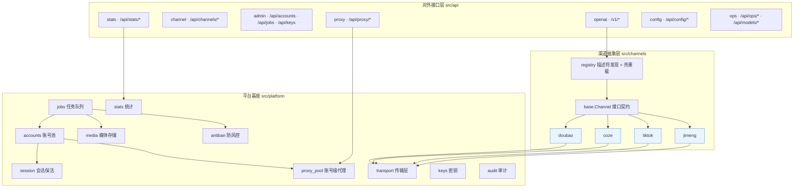

# Any Video2API

> 把即梦（jimeng）、TikTok Symphony、扣子（coze）、豆包（doubao）四个 AI 视频生成站点，统一为**一套 OpenAI 兼容接口 + 一个可插拔多渠道路由平台 + 一个可视化控制台**。

一个进程、一套基座、N 个渠道。新增渠道 = 1 份描述符 + 1 个适配器，平台代码 0 改动。

---

## 目录

- [核心特性](#核心特性)
- [快速开始](#快速开始)
- [控制台](#控制台)
- [接口总览](#接口总览)
- [架构](#架构)
- [防风控与登录态](#防风控与登录态)
- [账号级代理](#账号级代理)
- [目录结构](#目录结构)
- [部署](#部署)
- [配置](#配置)
- [安全](#安全)
- [文档](#文档)

---

## 核心特性

| 能力 | 说明 |
|---|---|
| **统一入口** | `/v1/*` OpenAI 兼容接口，用 `channel` 字段切换渠道 |
| **可插拔渠道** | 描述符（JSON）+ 适配器（Python）双文件接入，热重载免重启 |
| **账号池** | 轮换 / 最小负载 / 指定 / 并发，冷却与自动恢复 |
| **异步任务** | 提交 → 轮询 → 落盘，指数退避 + 人类化抖动 |
| **媒体缓存** | 分桶存储、URL 去重、流式下载、本地 URL 回源 |
| **防风控** | 限流 / 人类化节流 / 熔断 / 设备指纹固定 / 代理粘性 |
| **登录态延长** | 过期前刷新 + 心跳保活 + 凭据冗余备份 + OAuth 自动续期 |
| **账号级代理** | 一账号一固定出口 IP + 出口一致性校验 + 订阅池 |
| **多租户密钥** | 多 API Key、启停、渠道白名单 |
| **可视化控制台** | 9 个页面，账号按渠道标签页切分，统一管理账号 / 代理 / 任务 / 模型 / 配置 |
| **零浏览器依赖** | 协议优先，Playwright 仅作可选兜底与诊断 |

**已内置渠道**：`jimeng`（即梦）、`tiktok`（Symphony CUE）、`coze`（扣子）、`doubao`（豆包 / Seedance）。

---

## 快速开始

### 环境要求

- Python 3.11+（推荐 3.13）
- 无需浏览器；如需浏览器态兜底再装 `playwright`

### 安装与启动

```bash
git clone https://github.com/xingluoyuankong/any-video2api.git
cd any-video2api
python -m pip install -r requirements.txt
python -m uvicorn main:app --host 127.0.0.1 --port 8800
```

首次启动会自动生成一把 API Key（打印在控制台），也可写入 `config/setting.toml` 或环境变量 `AV2A_API_KEY`。

```powershell
# Windows 一键启动（自动建 venv）
.\scripts\start.ps1
```

打开控制台：<http://127.0.0.1:8800/console> · 接口文档：<http://127.0.0.1:8800/docs>

### 控制台登录

控制台用**账号密码**登录（不是 API Key）。首次启动会自动创建管理员账号：

```
用户名: admin
密码:   见 data/initial_admin.txt（首次启动生成，权限 600）
```

登录后可在右上角「账号」里改密码（改密会吊销全部会话，需重新登录）。
也可用环境变量 `AV2A_ADMIN_USER` / `AV2A_ADMIN_PASSWORD` 指定初始账号。

**两套凭据分工明确**：

| 用途 | 凭据 | 说明 |
|---|---|---|
| 控制台（人） | 用户名 + 密码 → 会话 cookie | `/api/*` |
| 程序调用（脚本/服务） | API Key（`u2a_...`） | `/v1/*`，控制台会话**不能**调用生成接口 |

### 30 秒上手

```bash
KEY="<启动时打印的 Key>"

# 1) 看有哪些渠道
curl http://127.0.0.1:8800/api/channels -H "X-API-Key: $KEY"

# 2) 导入账号（Cookie 文件）
curl -X POST http://127.0.0.1:8800/api/accounts/import-file \
  -H "X-API-Key: $KEY" -F "channel=jimeng" -F "file=@cookies.json"

# 3) 生成视频
curl -X POST http://127.0.0.1:8800/v1/videos/generations \
  -H "X-API-Key: $KEY" -H "Content-Type: application/json" \
  -d '{"channel":"jimeng","model":"jimeng-video-seedance-2.5","prompt":"a paper boat on a pond","duration":5}'

# 4) 查任务
curl http://127.0.0.1:8800/v1/videos/generations/<task_id> -H "X-API-Key: $KEY"
```

---

## 控制台

深色仪表盘，9 个页面（hash 路由，零构建原生 JS）：

| 页面 | 功能 |
|---|---|
| **概览** | 统计卡（渠道/账号/任务）+ 渠道能力卡 |
| **账号管理** | 渠道标签页（全部 / 即梦 / TikTok / 扣子 / 豆包）+ 批量检查/签到/保活/刷新额度 + 出口 IP/积分/成功失败列 |
| **代理出口** | 账号代理绑定 + 出口校验 + 批量导入 + 订阅池（global/cn） |
| **任务** | 任务列表、状态筛选、取消 |
| **密钥** | 多 API Key 管理（查看/启停/删除） |
| **日志** | 频道筛选 + 24h 事件统计 |
| **用量统计** | 按渠道/模型/日柱状图 + 按账号表 + 7/14/30 天筛选 |
| **模型与档位** | 按渠道分组模型卡 + 搜索 + 探测实时目录 |
| **配置** | 分区编辑（白名单写入，热生效）+ 渠道描述符查看 |

---

## 接口总览

鉴权：`X-API-Key: <key>` 或 `Authorization: Bearer <key>`

### 生成（OpenAI 兼容）

| 方法 | 路径 | 说明 |
|---|---|---|
| GET | `/v1/models` | 聚合全部渠道模型 |
| POST | `/v1/videos/generations` | 建视频任务（`channel` 选渠道） |
| GET | `/v1/videos/generations/{task_id}` | 查任务 |
| POST | `/v1/images/generations` | 建图片任务 |
| GET | `/v1/images/generations/{task_id}` | 查任务 |
| POST | `/v1/files` | 素材上传 |

### 渠道 / 账号 / 任务

| 方法 | 路径 | 说明 |
|---|---|---|
| GET | `/api/channels` | 全部渠道 + 能力矩阵 |
| GET | `/api/channels/{name}/endpoints` | 上游端点映射 |
| POST | `/api/channels/{name}/verify` \| `models` \| `credits` | 渠道级操作 |
| POST | `/api/channels/reload` | 热重载描述符 |
| GET | `/api/accounts?channel=` | 账号列表 |
| POST | `/api/accounts/import` \| `import-file` | 导入账号 |
| PATCH/DELETE | `/api/accounts/{id}` | 更新 / 删除 |
| POST | `/api/accounts/{id}/check` \| `checkin` | 检查 / 签到 |
| GET | `/api/accounts/{id}/session` | 会话健康 + 指纹 + 熔断 |
| GET/POST | `/api/accounts/{id}/backups` \| `restore` | 凭据快照 / 恢复 |
| POST | `/api/accounts/{id}/fingerprint/rotate` | 更换设备指纹 |
| GET/DELETE | `/api/jobs` \| `/api/jobs/{id}` | 任务列表 / 取消 |

### 代理 / 统计 / 模型 / 配置 / 运维

| 方法 | 路径 | 说明 |
|---|---|---|
| GET | `/api/proxy/accounts?channel=` | 账号代理列表 |
| POST | `/api/proxy/save` \| `delete` \| `direct` \| `check` \| `check-all` \| `bulk` \| `autobind` | 代理操作 |
| GET | `/api/proxy/stats` | 绑定数 / 状态分布 / 同 IP 计数 |
| GET/POST | `/api/proxy/pools` \| `pools/save` \| `refresh` \| `clear` | 订阅池 |
| GET | `/api/stats/overview` \| `usage` \| `credits` \| `runtime` | 统计与用量 |
| GET | `/api/models` \| `/api/models/{channel}/specs` | 模型目录 |
| POST | `/api/models/{channel}/probe` | 探测实时目录 |
| GET/POST | `/api/config` | 配置读写（热生效） |
| GET/POST | `/api/config/channels/{name}` | 渠道描述符 |
| POST | `/api/config/reload` | 重载配置与注册表 |
| POST | `/api/ops/verify-all` \| `checkin-all` \| `keepalive-all` \| `balance-all` | 批量运维 |
| GET | `/api/ops/status` | 运行态汇总 |
| GET/POST/DELETE | `/api/keys*` | 对外密钥管理 |
| GET | `/api/audit` | 脱敏审计 |

> 共 80 个路由。

---

## 架构



**依赖方向**：`api → channels → platform → core`，渠道不反向依赖平台，保证可插拔、可单测。

---

## 防风控与登录态

### 防风控（5 层）

| 层 | 机制 | 效果 |
|---|---|---|
| 限流 | 滑动窗口，每账号 60s 请求上限 | 超限等待，不发上游 |
| 节流 | 最小间隔 + 随机抖动 | 模拟人类操作节奏 |
| 熔断 | 连续风控/并发错误 → 打开 → 冷却 → 半开 | 打开时账号不参与调度 |
| 指纹 | 同账号永久固定 UA/语言/分辨率/时区 | 避免被判为新设备 |
| 代理 | 一号一 IP 粘性绑定 | 避免同 IP 多账号聚号 |

### 登录态延长（4 条路径）

1. **过期前刷新** — 距过期 < `lead_time` 即触发
2. **心跳保活** — 定时对有效账号发轻量验证，维持活跃
3. **冗余备份** — 凭据变更自动加密快照，失效可回退
4. **OAuth 续期** — `refresh_token` 到期自动换新

---

## 账号级代理

**为什么需要**：全局共享代理不够 —— 风控按「同一 IP 短时多账号」聚号时，全局代理只是把风险从网关 IP 平移到代理 IP，N 个账号仍一起被标记。真正的隔离粒度是**一个账号 ↦ 一条固定的住宅代理**。

**出口状态机**：`unchecked → ok / unreachable / not_effective / mismatch / disabled`

- `not_effective` = 实测出口 == 本机直连 IP（代理根本没生效）
- 三级回显服务探测：`api.ipify.org → httpbin.org/ip → ifconfig.me/ip`

**订阅池**：realm `global` / `cn` 两池不互通，支持 base64 订阅解析与健康分布。

**批量导入**（每行一条）：
```
账号ID 代理链接 [声明IP] [备注]
# 以 # 开头为注释；分隔符支持 空格/Tab/逗号/分号
```

---

## 目录结构

```
any-video2api/
├─ main.py                     单入口（FastAPI + 鉴权 + 静态 + 控制台）
├─ config/
│  ├─ setting.toml             平台配置
│  └─ channels/*.json          渠道描述符（jimeng / tiktok / coze / doubao）
├─ src/
│  ├─ core/                    公共件：config / crypto / errors / models
│  ├─ platform/                平台基座
│  │  ├─ accounts.py           账号池
│  │  ├─ jobs.py               任务队列 + Worker
│  │  ├─ media.py              媒体分桶存储
│  │  ├─ antiban.py            防风控（限流/节流/熔断/指纹/代理绑定）
│  │  ├─ session.py            会话保活
│  │  ├─ proxy_pool.py         账号级代理 + 出口校验 + 订阅池
│  │  ├─ transport.py          HTTP 传输（重试/代理/审计/防风控）
│  │  ├─ keys.py               对外密钥
│  │  ├─ audit.py              脱敏审计
│  │  ├─ stats.py              统计聚合
│  │  └─ db.py                 SQLite schema
│  ├─ channels/                渠道适配器
│  │  ├─ base.py               ★ 接口契约
│  │  ├─ registry.py           自动发现 + 热重载
│  │  └─ jimeng.py / tiktok.py / coze.py / doubao.py
│  └─ api/                     HTTP 路由（8 个模块）
├─ static/                     控制台前端（index.html / style.css / app.js）
├─ tests/                      集成冒烟测试
├─ scripts/                    启停与校验脚本
└─ docs/                       设计与流程文档
```

---

## 部署

> 现成可用的配置文件见 [`deploy/`](deploy/)：`nginx.conf`、`any-video2api.service`，
> 以及[部署记录与域名配置步骤](deploy/DEPLOY.md)。

### Docker

```dockerfile
FROM python:3.13-slim
WORKDIR /app
COPY requirements.txt .
RUN pip install --no-cache-dir -r requirements.txt
COPY . .
EXPOSE 8800
CMD ["python", "-m", "uvicorn", "main:app", "--host", "0.0.0.0", "--port", "8800"]
```

```bash
docker build -t any-video2api .
docker run -d --name any-video2api -p 8800:8800 \
  -v $(pwd)/data:/app/data -v $(pwd)/config:/app/config \
  -e AV2A_API_KEY=<你的密钥> any-video2api
```

### systemd

```ini
[Unit]
Description=Any Video2API
After=network.target

[Service]
Type=simple
User=ubuntu
WorkingDirectory=/opt/any-video2api
Environment="AV2A_API_KEY=<你的密钥>"
ExecStart=/usr/bin/python3 -m uvicorn main:app --host 127.0.0.1 --port 8800
Restart=always
RestartSec=5

[Install]
WantedBy=multi-user.target
```

```bash
sudo systemctl daemon-reload && sudo systemctl enable --now any-video2api
```

### Nginx 反向代理

```nginx
server {
    listen 80;
    server_name your-domain.com;

    client_max_body_size 64m;

    location / {
        proxy_pass http://127.0.0.1:8800;
        proxy_set_header Host $host;
        proxy_set_header X-Real-IP $remote_addr;
        proxy_set_header X-Forwarded-For $proxy_add_x_forwarded_for;
        proxy_set_header X-Forwarded-Proto $scheme;
        proxy_read_timeout 1800s;   # 长任务轮询
        proxy_buffering off;        # SSE 友好
    }
}
```

---

## 配置

`config/setting.toml`（控制台「配置」页可在线编辑，白名单键热生效）：

```toml
[server]
host = "127.0.0.1"
port = 8800

[api]
api_key = ""            # 留空则只用数据库多密钥（首次启动自动生成）
auth_disabled = false

[antiban]               # 防风控
rpm_limit = 60
min_interval = 1.0
jitter = 0.5
failure_threshold = 3
cooldown = 120
fingerprint = true

[session]               # 登录态保活
keepalive_interval = 1800
lead_time = 3600
backup_keep = 5

[proxy]                 # 账号级代理
enabled = true
probe_timeout = 15
max_per_ip = 3
```

**环境变量**：`AV2A_CONFIG` / `AV2A_API_KEY` / `AV2A_CHANNELS_DIR` / `AV2A_DEV_KEY`（兼容旧前缀 `UNIFIED_*`）。

---

## 安全

- **控制台**：账号密码登录（PBKDF2-HMAC-SHA256 加盐 20 万轮，恒定时间比较防用户名枚举）；
  会话 cookie 为 `HttpOnly` + `SameSite=Lax`，库内只存 token 摘要，7 天滑动续期，改密即吊销全部会话；
  登录接口按 **IP + 用户名双维度滑动窗口限流**（超限 429）防暴力破解，成功/失败/限流均落审计日志；
  HTTPS 访问时自动置 `Secure`（识别 `X-Forwarded-Proto`）
- **程序接口**：`/v1/*` 只认 API Key；控制台会话不能调用生成接口
- 凭据落库前加密（Windows DPAPI / 非 Windows XOR 回退）
- 审计只记录 `body_shape` 与请求头**名**，值全部脱敏，凭据零落盘
- 首次启动强制生成随机 API Key 与随机管理员密码（写入 `data/initial_admin.txt`，`600`）
- 配置页 `api_key` 返回时脱敏为 `***`；写入只允许白名单节与键
- 代理链接在列表中脱敏为 `user:***@`，仅实际使用时取完整值
- 生产环境请立即修改初始密码，并将 `data/` 与 `config/` 挂载持久化

---

## 文档

| 文档 | 内容 |
|---|---|
| [`docs/REVERSE_ENGINEERING.md`](docs/REVERSE_ENGINEERING.md) | 通用逆向分析流程（8 阶段 + 流程图） |
| [`docs/ADD_CHANNEL.md`](docs/ADD_CHANNEL.md) | 新增渠道接入流程 + 接口契约 |
| [`docs/ARCHITECTURE.md`](docs/ARCHITECTURE.md) | 架构分层 + 三项目功能映射 |
| [`docs/ANTIBAN_AND_SESSION.md`](docs/ANTIBAN_AND_SESSION.md) | 防风控 + 登录态保活 |
| [`docs/PROXY_AND_UI.md`](docs/PROXY_AND_UI.md) | 账号级代理 + 控制台 |
| [`docs/UI_PAGES.md`](docs/UI_PAGES.md) | 9 个页面与功能清单 |

---

## 许可

仅供学习与授权范围内的技术研究使用。使用者需自行确保对目标站点的访问符合其服务条款与当地法律法规。
