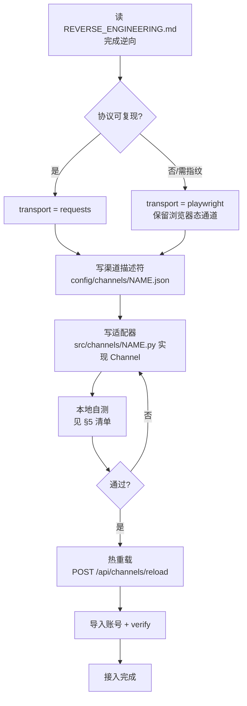

# 新增渠道接入流程与接口契约

> 目标：接入一个新站点，**只写两个文件**（一份描述符 + 一个适配器），
> 平台基座（账号池/任务队列/媒体/审计/OpenAI 层）**一行都不用改**。

---

## 0. 接入总流程



**接入前后平台侧改动量：0 行代码**（仅新增描述符与适配器两个文件）。

---

## 1. 渠道描述符 schema（`config/channels/<name>.json`）

```jsonc
{
  "adapter": "src.channels.jimeng:JimengChannel",  // 必填：模块:类名
  "display_name": "即梦 (Jimeng)",
  "kind": "mixed",                 // video | image | chat | mixed
  "base_url": "https://jimeng.jianying.com",
  "proxy": "",                     // 出站代理，如 "http://127.0.0.1:7897"
  "timeout": 120,
  "user_agent": "Mozilla/5.0 ...",
  "transports": ["requests", "playwright"],   // 声明可用传输方式

  "supports": {                    // 原子能力开关，决定 /api/channels 的能力矩阵
    "video": true, "image": true, "upload": true,
    "checkin": true, "oauth": true, "credits": true,
    "models": true, "verify": true
  },

  "models": {                      // 公共别名 -> 上游真实 ID
    "jimeng-video-seedance-2.5": "dreamina_seedance_45_pro"
  },

  "endpoints": {                   // 逆向结果落地点：逻辑名 -> {method, path, params}
    "generate": {"method": "POST", "path": "/mweb/v1/aigc_draft/generate"},
    "poll":     {"method": "POST", "path": "/mweb/v1/get_history_by_ids"}
  }
}
```

| 字段 | 必填 | 说明 |
|---|---|---|
| `adapter` | 是 | 指向 `Channel` 子类；省略则按 `src.channels.<name>:<Name>Channel` 猜 |
| `base_url` | 是 | 上游根；adapter 用它拼 URL |
| `endpoints` | 建议 | 全部上游路径集中在此，便于审计与热改 |
| `models` | 建议 | 别名表，隔离上游真实 ID 变更 |
| `supports` | 建议 | 能力矩阵，前端/调度器据此决策 |
| `transports` | 可选 | 声明需要的传输方式 |

---

## 2. Channel 接口契约（`src/channels/base.py`）

### 2.1 必须实现

| 方法 | 签名 | 职责 |
|---|---|---|
| `build_headers` | `(secret, path, body=None, extra=None) -> dict` | 构造含签名/CSRF 的全部请求头 |
| `submit` | `(secret, req: GenerateRequest) -> SubmitResult` | 提交生成，返回上游任务 ID |
| `poll` | `(secret, upstream_task_id, req=None) -> PollResult` | 轮询并归一化状态与产物 |

### 2.2 按能力实现（`supports` 里为 true 才需要）

| 方法 | 签名 | 职责 |
|---|---|---|
| `verify` | `(secret) -> VerifyResult` | 验证登录态 |
| `list_models` | `(secret) -> list[ModelSpec]` | 实时模型目录 |
| `credits` | `(secret) -> CreditView` | 额度查询 |
| `checkin` | `(secret) -> dict` | 签到 |
| `refresh` | `(secret) -> AccountSecret \| None` | OAuth 刷新 |
| `upload` | `(secret, data, filename, content_type) -> AssetRef` | 素材上传 |
| `classify_error` | `(payload) -> str` | 上游错误码 -> 统一 error_class |

### 2.3 数据契约（只传这些类型）

```python
AccountSecret(cookies, browser_state, oauth, extra)   # 平台解密后传入
GenerateRequest(channel, kind, model, prompt, mode,   # 平台解析 /v1/* 后传入
                duration, ratio, resolution, size,
                images, params, account_mode, account_id,
                timeout, idempotency_key)
SubmitResult(upstream_task_id, transport, accepted, error, error_class, raw)
PollResult(status, media, covers, error, error_class, progress, raw)
ModelSpec(id, alias, display_name, kind, resolutions, durations, ratios, ...)
CreditView(total, allocatable, buckets, error, raw)
VerifyResult(ok, status, message, raw)
AssetRef(uri, url, raw)
```

**红线**：所有 `raw` 必须是 `redact()` 之后的；凭据、签名、token 绝不进 `raw`。

---

## 3. 适配器最小骨架

```python
# src/channels/acme.py
from src.channels.base import (Channel, AccountSecret, GenerateRequest,
                               SubmitResult, PollResult, VerifyResult)
from src.core.errors import UpstreamError, classify_error, find_values, redact
from src.platform.transport import HttpClient


class AcmeChannel(Channel):
    name = "acme"

    def __init__(self, spec, log=None):
        super().__init__(spec, log)
        self._clients = {}

    def _client(self, account_id=""):
        if account_id not in self._clients:
            self._clients[account_id] = HttpClient(
                base_url=self.spec.base_url, proxy=self.spec.proxy or None,
                timeout=self.spec.timeout, user_agent=self.spec.user_agent,
                channel=self.name, account_id=account_id)
        return self._clients[account_id]

    def _ep(self, name):
        ep = (self.spec.endpoints or {}).get(name, {})
        return ep.get("method", "POST"), ep.get("path", "")

    def build_headers(self, secret, path, body=None, extra=None):
        h = {"Cookie": "; ".join(f"{k}={v}" for k, v in (secret.cookies or {}).items())}
        # 如站点有签名：在此计算（见 jimeng 的 md5 sign）
        if extra: h.update(extra)
        return h

    def verify(self, secret):
        m, p = self._ep("verify")
        try:
            r = self._client().request(m, p, headers=self.build_headers(secret, p))
            ok = str(r.get("code", 0)) in ("0", "")
            return VerifyResult(ok=ok, status="active" if ok else "invalid", raw=redact(r))
        except UpstreamError as e:
            return VerifyResult(ok=False, status="invalid", message=str(e))

    def submit(self, secret, req):
        m, p = self._ep("generate")
        body = {"prompt": req.prompt, "model": (self.spec.models or {}).get(req.model, req.model),
                "duration": req.duration, **req.params}
        r = self._client().request(m, p, body=body, headers=self.build_headers(secret, p, body))
        tid = find_values(r, {"task_id", "id"})
        return SubmitResult(upstream_task_id=str(tid[0]) if tid else "",
                            transport="requests", raw=redact(r))

    def poll(self, secret, upstream_task_id, req=None):
        m, p = self._ep("poll")
        r = self._client().request(m, p, body={"task_id": upstream_task_id},
                                   headers=self.build_headers(secret, p))
        urls = [u for u in find_values(r, {"video_url", "download_url"}) if str(u).startswith("http")]
        if urls:      st = "success"
        elif "fail" in str(r).lower(): st = "failed"
        else:         st = "processing"
        return PollResult(status=st, media=list(dict.fromkeys(urls)), raw=redact(r))

    def classify_error(self, payload):
        code = payload.get("code") if isinstance(payload, dict) else None
        return classify_error(code, str(payload))
```

配合描述符 `config/channels/acme.json` 即完成接入。

---

## 4. 错误分类对齐

渠道必须把上游错误码翻译到统一 `error_class`，平台据此决定"快速失败 / 冷却账号 / 重试"：

| error_class | 平台行为 | 典型码 |
|---|---|---|
| `quota` | 任务立即失败，不重试 | jimeng `1006/1007`、coze `402` |
| `auth_or_risk` | 账号冷却 + 标记失效 | `401/403/4013`、tiktok `10001106` |
| `concurrency` | 退避重试 | `1310`、`429` |
| `timeout` | 退避重试至超时 | 网络异常 |
| `content` | 立即失败（内容审核） | 违规/审核 |
| `upstream` | 默认重试 | 其它 |

---

## 5. 自测清单（接入必过）

```mermaid
flowchart LR
    A[POST /api/channels/reload] --> B[GET /api/channels]
    B --> C[POST /api/accounts/import]
    C --> D[POST /api/accounts/{id}/check]
    D --> E[POST /api/channels/NAME/models]
    E --> F[POST /api/channels/NAME/credits]
    F --> G[POST /v1/videos/generations]
    G --> H[GET /v1/videos/generations/{task_id}]
    H --> I[GET /api/audit 检查无泄漏]
```

- [ ] `GET /api/channels` 能看到新渠道且 `capabilities` 正确
- [ ] 导入账号后 `check` 返回 `active`
- [ ] `models` 能拉到实时目录
- [ ] `credits` 能拉到额度（或明确返回"不支持"）
- [ ] 真实提交一次，能拿到上游任务 ID
- [ ] 轮询到 `success`，产物落盘到 `data/media/<bucket>/`
- [ ] `GET /api/audit` 里**没有** cookie/token/签名明文
- [ ] 上游额度不足时返回 `error_class=quota` 且不重试

---

## 6. 常见坑（来自三项目实战）

| 坑 | 现象 | 对策 |
|---|---|---|
| 缩略图当成品 | 轮询到 webp/svg 就判成功 | 成功必须匹配 `.mp4/.webm/.mov`（见 jimeng `_normalize_poll`） |
| 公共参数遗漏 | 单测过、真实提交 403 | 把 `aid/version/device_platform` 固化进 `_default_params` |
| 签名取整段路径 | 换路径后签名失效 | 严格按逆向结果取字段（jimeng 取 `path[-7:]`） |
| 会话静默过期 | 偶发 401 | 加 `auth_or_risk` 分类 + 账号冷却 + 重登引导 |
| 轮询风暴 | 上游限流 | 指数退避（4/8/15s）+ `max_poll_interval` |
| 大文件内存爆 | 下载 OOM | 流式写临时文件 + 原子替换（见 `media.fetch_to_bucket`） |
| 凭据泄漏进日志 | 审计里出现 token | 只记 `body_shape` + 头名，值全部 `redact()` |
