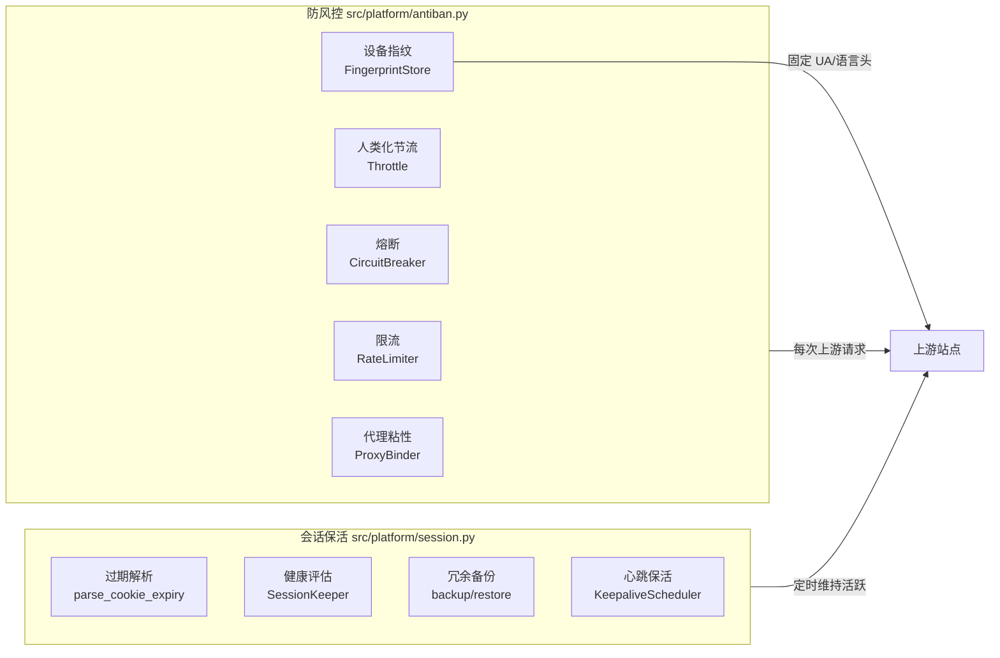
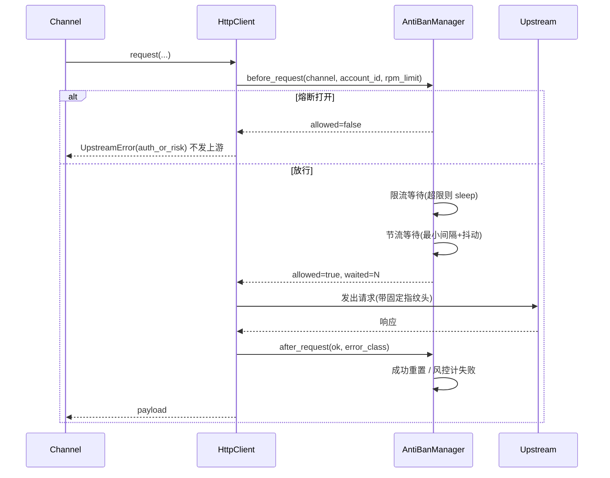
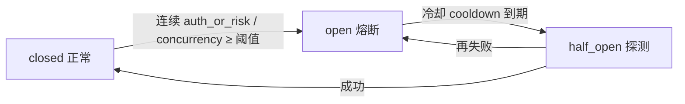
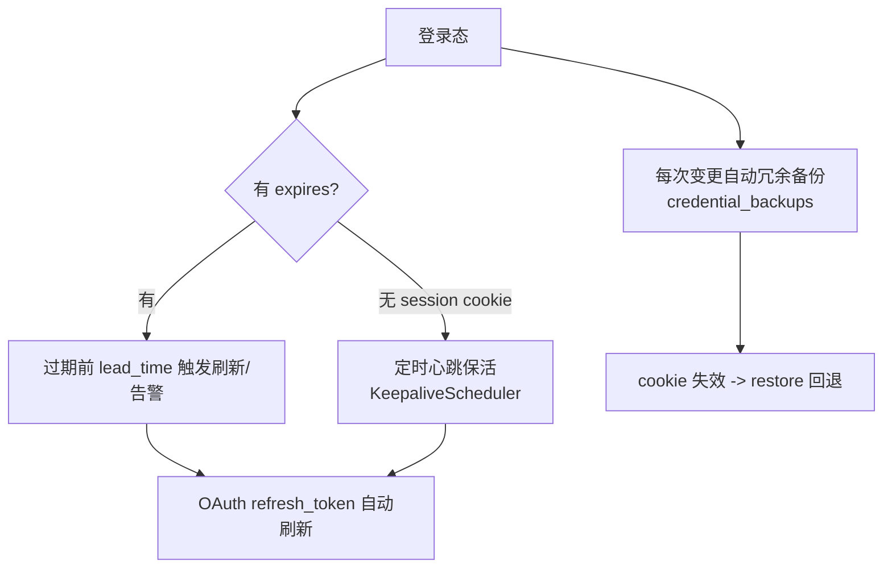

# 防风控 与 登录态保活

> 两个能力的实现说明、配置、接口与运维口径。
> 代码：`src/platform/antiban.py`（防风控）、`src/platform/session.py`（会话保活）。

---

## 0. 总览



两条能力线在 `transport.py` / `accounts.py` / `jobs.py` / `main.py` 四处汇入主链路。

---

## 1. 防风控

### 1.1 五层机制

| 层 | 组件 | 作用 | 触发点 |
|---|---|---|---|
| 1 限流 | `RateLimiter` | 滑动窗口，账号 60s 内请求数上限 | 每次请求前 |
| 2 节流 | `Throttle` | 同账号最小间隔 + 随机抖动，模拟人类节奏 | 每次请求前 |
| 3 熔断 | `CircuitBreaker` | 连续风控/并发错误 → 打开 → 冷却 → 半开 | 请求前后 |
| 4 指纹 | `FingerprintStore` | 同账号永远同一套 UA/语言/分辨率/时区 | 建号时 + 每请求头 |
| 5 代理 | `ProxyBinder` | 一号一 IP，稳定哈希绑定 | 建号时 |

### 1.2 请求生命周期（集成后）



### 1.3 熔断状态机



- 熔断打开的账号在 `accounts._eligible()` 中**直接跳过**，不再派发任务。
- 冷却是临时的，到期自动转半开，一次成功即恢复，避免误封好账号。

### 1.4 设备指纹（最关键）

被风控最常见的触发原因是**同一账号的指纹漂移**（换 UA、换分辨率、换时区 → 被判定为新设备 → 触发二次验证）。

平台做法：
1. 建号时按 `sha256(account_id)` **稳定哈希**生成一套指纹并落库 `device_fingerprints`；
2. 之后每次请求，`accounts.secret()` 把指纹注入 `secret.extra["fingerprint"]`；
3. 渠道 `build_headers()` 调 `fingerprint_headers(secret)` 覆盖 UA / Accept-Language；
4. `HttpClient` 构造时也用指纹 UA 设置会话级头。

只有 `POST /api/accounts/{id}/fingerprint/rotate` 会主动更换（用于登录态彻底失效后）。

---

## 2. 登录态保活（延长保存时长）

### 2.1 四条延长路径



| 路径 | 机制 | 效果 |
|---|---|---|
| ① 过期前刷新 | `needs_refresh()` 在距过期 < `lead_time` 时返回 True | 主动换新，不等失效 |
| ② 心跳保活 | `KeepaliveScheduler` 每 `keepalive_interval` 对有效账号发轻量 verify | 维持会话活跃，延长 session cookie 寿命 |
| ③ 冗余备份 | 每次凭据变更自动 `backup()`，保留最近 N 份 | cookie 失效可 `restore` 回退 |
| ④ OAuth 刷新 | 渠道 `refresh()` + 平台 `keeper` 记录 | token 到期自动续 |

### 2.2 健康分级与建议动作

| health | 含义 | 建议动作 |
|---|---|---|
| `healthy` | 距过期 > lead_time | `reuse` 继续用 |
| `expiring` | 距过期 < lead_time | `refresh` 尽快刷新 |
| `expired` | 已过期 | `relogin` 重新登录 |
| `unknown` | session cookie / 无过期信息 | 依赖心跳保活维持 |

连续保活失败达 `relogin_threshold` → `health.action = relogin`。

### 2.3 心跳保活（回调注入）

`KeepaliveScheduler` 不直接依赖渠道，通过两个回调工作（避免循环依赖）：

```python
KeepaliveScheduler(
    lister   = lambda: [{"id": r["id"], "channel": r["channel"]} for r in manager.raws()],
    verifier = lambda aid: registry.get(row["channel"]).verify(manager.secret(aid)).ok,
    interval = config.session_keepalive_interval,
)
```

由 `main.py` 装配并在 lifespan 中 `start()` / `stop()`。

---

## 3. 配置（`config/setting.toml`）

```toml
[antiban]
enabled = true
rpm_limit = 60            # 每账号每 60s 请求上限
min_interval = 1.0        # 同账号两次请求最小间隔（秒）
jitter = 0.5              # 间隔随机抖动上限（秒）
failure_threshold = 3     # 连续风控/并发错误 -> 熔断
cooldown = 120            # 熔断冷却（秒）
proxy_pool = []           # 代理池，账号粘性绑定；空则不绑定
fingerprint = true        # 固定设备指纹

[session]
enabled = true
keepalive_interval = 1800 # 心跳间隔（秒）
lead_time = 3600          # 距过期多少秒视为即将过期
backup_keep = 5           # 凭据快照保留份数
relogin_threshold = 3     # 连续失败 -> 建议重登
```

---

## 4. 接口

### 防风控

| 方法 | 路径 | 说明 |
|---|---|---|
| GET | `/api/antiban/status` | 限流 / 熔断 / 代理绑定总览 |
| POST | `/api/antiban/reset` | 重置熔断（`?account_id=&channel=` 或全部） |

### 会话保活

| 方法 | 路径 | 说明 |
|---|---|---|
| GET | `/api/sessions` | 全部账号会话健康汇总 |
| GET | `/api/accounts/{id}/session` | 单账号：过期 / 健康 / 指纹 / 代理 / 熔断 |
| GET | `/api/accounts/{id}/backups` | 凭据快照列表 |
| POST | `/api/accounts/{id}/backups` | 手动备份 |
| POST | `/api/accounts/{id}/restore` | 从快照恢复凭据 |
| POST | `/api/accounts/{id}/fingerprint/rotate` | 更换设备指纹 |
| POST | `/api/keepalive/run` | 手动触发一轮保活 |

---

## 5. 新增数据表（惰性创建，未改 `db.py`）

| 表 | 用途 | 来源 |
|---|---|---|
| `device_fingerprints` | 账号固定指纹 | antiban.py |
| `proxy_bindings` | 账号↔代理粘性绑定 | antiban.py |
| `session_events` | 保活/刷新/备份/恢复活动流水 | session.py |
| `credential_backups` | 加密凭据快照 | session.py |
| `session_state` | 每账号会话健康计数 | session.py |

---

## 6. 运维建议

1. **代理池**：多账号务必配 `proxy_pool`，否则同 IP 多账号是最高危的风控特征。
2. **rpm_limit**：按上游实测调整。jimeng 目录接口宽松，提交接口收紧；tiktok 更严，建议 ≤ 20。
3. **熔断阈值**：不要设太小（如 1），瞬时网络抖动会误熔断；3 是稳妥起点。
4. **心跳间隔**：`keepalive_interval` 太短（< 5 分钟）反而像机器人；30 分钟是自然节奏。
5. **备份保留**：`backup_keep` 越大越安全但占库空间；5 份足够覆盖一次误覆盖。
6. **指纹一致性**：不要频繁 `rotate`，指纹漂移本身就是风控信号；仅在确认账号被标记后使用。

---

## 7. 验证

```powershell
cd E:\API管理工具\any-video2api
$env:PYTHONPATH="."
python tests/smoke_antiban_session.py
```

覆盖 16 项：指纹稳定性、过期解析（含毫秒归一化）、健康分级、备份/恢复往返、指纹轮换、
熔断三态与拦截、限流、节流抖动、渠道头指纹注入、保活调度。
