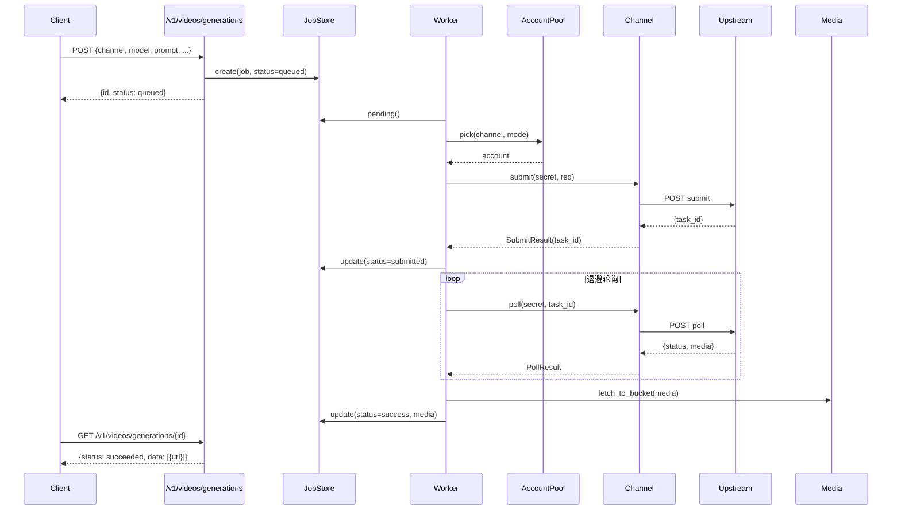

# 统一架构说明

## 1. 一句话

把 jimeng2api、tiktok2api、coze2api 三个"各自一套"的反代项目，整合为
**一个进程 + 一套基座 + N 个可插拔渠道**；渠道差异全部收敛到"描述符 + 适配器"两个文件。

---

## 2. 分层架构

```mermaid
flowchart TB
    subgraph API[对外接口层 src/api]
        O[openai_routes<br/>/v1/models /v1/videos /v1/images /v1/files]
        C[channel_routes<br/>/api/channels/*]
        A[admin_routes<br/>/api/accounts /api/jobs /api/keys /api/audit]
    end

    subgraph CORE[渠道抽象层 src/channels]
        B[base.Channel<br/>接口契约]
        R[registry<br/>描述符发现 + 实例化]
        J[jimeng.py]:::impl
        T[tiktok.py]:::impl
        Z[coze.py]:::impl
    end

    subgraph PLAT[平台基座 src/platform]
        ACC[accounts 账号池]
        JOB[jobs 任务队列+Worker]
        MED[media 媒体存储]
        KEY[keys 对外密钥]
        AUD[audit 脱敏审计]
        TR[transport HTTP 传输]
    end

    subgraph CORE2[公共件 src/core]
        CFG[config]  CRY[crypto]  ERR[errors]  MOD[models]
    end

    O --> R
    C --> R
    A --> ACC
    R --> B
    B --> J & T & Z
    J & T & Z --> TR
    ACC --> CRY
    JOB --> ACC
    JOB --> MED
    JOB --> AUD
    classDef impl fill:#e8f4ff,stroke:#4a90d9
```

**依赖方向**：API → channels → platform → core。渠道**不反向依赖** platform/api，
保证可插拔、可单测。

---

## 3. 目录结构

```
any-video2api/
├─ main.py                     单入口（FastAPI + 鉴权中间件 + 媒体 + 控制台）
├─ config/
│  ├─ setting.toml             平台配置
│  └─ channels/                渠道描述符（数据）
│     ├─ jimeng.json
│     ├─ tiktok.json
│     └─ coze.json
├─ src/
│  ├─ core/                    公共件：config / crypto / errors / models
│  ├─ platform/                平台基座（与渠道无关）
│  │  ├─ accounts.py           账号池（轮换/冷却/恢复/指纹/代理绑定）
│  │  ├─ jobs.py               任务队列 + Worker（submit→poll→落盘，含抖动）
│  │  ├─ media.py              媒体分桶存储 + 流式下载
│  │  ├─ keys.py               对外 API Key
│  │  ├─ audit.py              脱敏审计
│  │  ├─ transport.py          HTTP 客户端（重试/代理/审计/防风控）
│  │  ├─ antiban.py            防风控（限流/节流/熔断/指纹/代理）
│  │  ├─ session.py            会话保活（过期/健康/备份/心跳）
│  │  └─ db.py                 SQLite schema
│  ├─ channels/                渠道适配器（差异收敛点）
│  │  ├─ base.py               ★ 接口契约
│  │  ├─ registry.py           自动发现 + 热重载
│  │  ├─ jimeng.py / tiktok.py / coze.py
│  └─ api/                     HTTP 路由
├─ tests/                      集成冒烟测试
├─ docs/
│  ├─ REVERSE_ENGINEERING.md   通用逆向分析流程（流程图）
│  ├─ ADD_CHANNEL.md           新增渠道流程 + 接口契约
│  ├─ ANTIBAN_AND_SESSION.md   防风控 + 登录态保活
│  └─ ARCHITECTURE.md          本文件
└─ data/                       运行时数据（db / media / profiles）
```

---

## 4. 三个项目 → 统一平台：功能映射

### 4.1 平台基座（三者共性，统一为一份）

| 能力 | jimeng2api | tiktok2api | coze2api | 统一实现 |
|---|---|---|---|---|
| 账号池 | `account_manager.py` | `account_manager.py` | `pool.py` | `platform/accounts.py` |
| 加密 | `crypto.py`(DPAPI) | — | `secrets.py`(DPAPI) | `core/crypto.py` |
| 任务队列 | `task_store/worker` | `job_store/worker` | `worker.py` | `platform/jobs.py` |
| 媒体存储 | `media_store.py` | `media_store.py` | `media.py` | `platform/media.py` |
| 对外密钥 | 单 key | `auth.py`(多 key) | 单 key | `platform/keys.py` |
| 审计 | `audit.py` | `request_trace.py` | `upstream_events` | `platform/audit.py` |
| 存储 | sqlite | json | sqlite | `platform/db.py`(sqlite) |
| 错误分类 | `classify_upstream_error` | 内联 | `deny_reason` | `core/errors.py` |
| 防风控 | 无 | 无 | 无 | `platform/antiban.py`（新增） |
| 会话保活 | 无 | 无 | OAuth 刷新 | `platform/session.py`（新增） |

### 4.2 渠道差异（收敛到描述符 + adapter）

| 维度 | jimeng | tiktok | coze | 落点 |
|---|---|---|---|---|
| base_url | jimeng.jianying.com | ads.tiktok.com | www/api/code.coze.cn | 描述符 |
| 鉴权 | MD5 轻签名 | Cookie+CSRF | OAuth/Cookie | `adapter.build_headers` |
| 提交 | aigc_draft/generate | cue/*/create_generate_task | workflow(_api)/run | `adapter.submit` |
| 轮询 | get_history_by_ids | generate-task/check | workflow/get_process | `adapter.poll` |
| 任务 ID | history_id | taskId | execute_id | `SubmitResult` |
| 额度 | user_credit | 无 | balance/check | `adapter.credits` |
| 签到 | credit_receive | 无 | /checkin | `adapter.checkin` |
| 模型目录 | common_config | api_map.json | model_list | `adapter.list_models` |

### 4.3 对外接口（三项目 OpenAI 兼容层 → 统一）

| 统一接口 | jimeng2api | tiktok2api | coze2api |
|---|---|---|---|
| `GET /v1/models` | ✅ | ✅ | ✅ |
| `POST /v1/videos/generations` | ✅ | ✅ | ✅ |
| `GET /v1/videos/generations/{id}` | ✅ | ✅ | ✅ |
| `POST /v1/images/generations` | ✅ | ✅ | — |
| `POST /v1/files` | ✅ | — | — |
| 渠道选择 | — | — | — | **新增：`channel` 字段** |

> 关键增强：统一后所有生成接口多一个 `channel` 字段（`jimeng` / `tiktok` / `coze`），
> 一个 endpoint 调用全部渠道。

---

## 5. 一次生成请求的数据流



---

## 6. 设计取舍

| 决策 | 理由 |
|---|---|
| 描述符用 JSON 而非代码 | 加渠道不改代码；可热重载；便于审计 |
| 渠道不得反向依赖平台 | 可插拔、可单测；避免循环依赖 |
| 任务队列单线程 + 渠道内并发 | 三项目均为此模型；简单可控，退避统一 |
| 成功必须落盘真实媒体 | 杜绝"缩略图当成品"的假成功 |
| 审计只记形状不记值 | 凭据零泄漏；满足最小伤害原则 |
| 保留 playwright transport 通道 | 指纹/风控严格的渠道仍需浏览器态兜底 |
