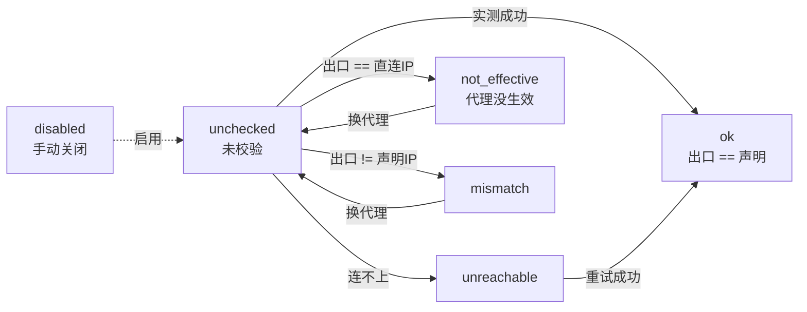
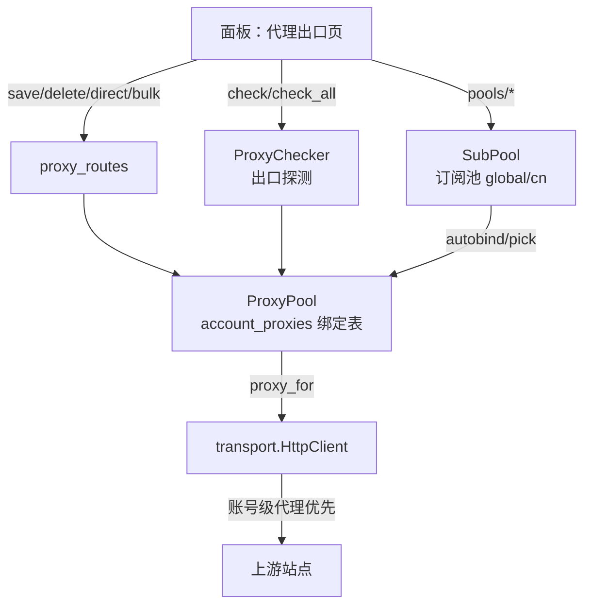
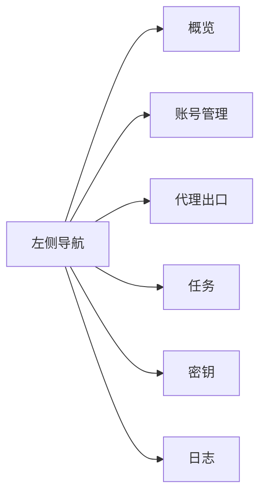

# 账号级代理 与 控制台前端

> 参考 `workbuddy2api-panel` 的设计移植：**一账号 ↦ 一条固定出口代理** + 出口一致性校验 + 订阅池，
> 以及全新深色仪表盘控制台。
> 代码：`src/platform/proxy_pool.py`、`src/api/proxy_routes.py`、`static/{index.html,style.css,app.js}`。

---

## 0. 为什么需要「账号级」代理

全局共享代理不够。风控按「同一 IP 短时多账号」聚号时，全局代理只是把风险从网关 IP 平移到代理 IP——N 个账号仍然一起被标记。

真正的隔离粒度是 **一个账号 ↦ 一条固定的住宅代理**：出口 IP 恒定、与其它账号不复用、地理位置自洽。

**配了还不够，必须校验**：配错 / 代理失效时请求照样「成功」，唯一症状是出口 IP 没变，而线上几乎不可观测。所以要把「这条代理现在真的按声明的 IP 出去吗」变成一等状态。

---

## 1. 出口状态机



| 状态 | 含义 | 处置建议 |
|---|---|---|
| `unchecked` | 尚未校验 | 点「校验」 |
| `ok` | 出口 == 声明 IP | 正常 |
| `unreachable` | 代理连不上 | 换链接 |
| `not_effective` | 出口 == 本机直连 IP（代理没生效） | 换链接 |
| `mismatch` | 出口 != 声明 IP | 核对声明或换链接 |
| `disabled` | 手动关闭 | — |

校验用三级回显服务（`api.ipify.org` → `httpbin.org/ip` → `ifconfig.me/ip`），直连出口 IP 缓存 5 分钟。

---

## 2. 代理数据流



**关键**：`HttpClient` 构造时优先取 `proxy_pool.proxy_for(account_id)`，未绑定才回落渠道默认出口。这样防风控的「一号一 IP」在传输层自动生效，渠道代码零改动。

---

## 3. 代理接口

| 方法 | 路径 | 说明 |
|---|---|---|
| GET | `/api/proxy/accounts?channel=` | 账号代理列表（含未绑定） |
| POST | `/api/proxy/save` | 保存/更新绑定 |
| POST | `/api/proxy/delete` | 删除绑定 |
| POST | `/api/proxy/direct` | 切直连（语义化 remove） |
| POST | `/api/proxy/check` | 校验单账号出口 |
| POST | `/api/proxy/check-all?channel=` | 批量校验 |
| POST | `/api/proxy/bulk` | 批量导入（items 或 text 逐行） |
| POST | `/api/proxy/autobind` | 从订阅池自动分配 |
| GET | `/api/proxy/stats` | 绑定数 / 状态分布 / 同 IP 计数 / 超限 IP |
| GET | `/api/proxy/pools` | 订阅池列表（global / cn） |
| POST | `/api/proxy/pools/save` | 保存订阅（replace / append） |
| POST | `/api/proxy/pools/refresh` | 刷新订阅（拉取解析） |
| POST | `/api/proxy/pools/clear` | 清空订阅池 |

**批量导入文本格式**（每行一条）：
```
账号ID 代理链接 [声明IP] [备注]
# 以 # 开头为注释；分隔符支持 空格/Tab/逗号/分号
```
逐条返回结果，**不做整体回滚**——已验证可用的绑定不该被一条拼错的链接拖回去。

---

## 4. 数据表（惰性创建）

| 表 | 用途 |
|---|---|
| `account_proxies` | 账号↔代理绑定（proxy / expected_ip / enabled / auto / label / note） |
| `proxy_runtime` | 运行态（state / actual_ip / checked_at / last_error） |
| `proxy_pools` | 订阅池（realm / subs_json / refreshed_at / last_error） |
| `proxy_pool_entries` | 订阅解析出的出口条目（ok / fail_count / last_ok_at） |

---

## 5. 控制台前端

### 5.1 页面结构



| 页面 | 内容 |
|---|---|
| **概览** | 渠道卡片（能力/模型数）、账号统计、任务统计 |
| **账号管理** | **按渠道分组**（jimeng / tiktok / coze 可折叠）；列：健康色条 / 账号 / 渠道 / 状态 / 额度 / 会话 / 代理 / 操作 |
| **代理出口** | 账号代理列表 + 校验/直连/批量导入 + 订阅池（global/cn） |
| **任务** | 任务列表，按状态筛选，可取消 |
| **密钥** | API Key 列表，新建/启停/删除/查看 |
| **日志** | 审计事件流 |

### 5.2 设计语言

- 深色仪表盘：冷石墨基调 + 单一靛蓝强调，语义色只给状态
- 明暗双主题（`data-theme` 切换，存 localStorage）
- 观测数值统一等宽 + `tabular-nums` 对齐
- 状态徽章 / 表格健康色条（真实 `td.mark`，避免伪元素错位）
- 零依赖原生 JS，hash 路由，toast，危险操作二次确认

### 5.3 多平台账号管理

any-video2api 天然多渠道，前端**按渠道分组**展示：

```
账号管理
├─ 即梦 (jimeng)   3 个账号 · 2 活跃
│   └─ 表格行...
├─ TikTok          1 个账号
└─ 扣子 (coze)     2 个账号 · 1 冷却
```

每行独立操作（检查 / 签到 / 编辑 / 备份 / 删除），顶部可按渠道筛选。

---

## 6. 配置

```toml
[proxy]
enabled = true          # 账号级代理总开关（关则全部走渠道默认出口）
probe_timeout = 15      # 出口探测超时（秒）
max_per_ip = 3          # 同一出口 IP 允许承载的账号数上限（0 = 不限制）
```

---

## 7. 运维建议

1. **优先给高价值账号配固定住宅 IP**，不要所有账号共享一条代理。
2. **配完立刻校验**（`check-all`），只有 `ok` 才说明代理真的生效。
3. **盯 `stats.ip_counts`**：同一 IP 超过 `max_per_ip` 就是风控靶心，面板会标 `over_limit`。
4. **订阅池按 realm 分组**：global / cn 两池不互通，避免跨境 IP 混用。
5. **批量导入用文本粘贴**，比逐个点快得多，且逐条反馈错误。

---

## 8. 验证

```powershell
cd E:\API管理工具\any-video2api
$env:PYTHONPATH="."
python -m uvicorn main:app --host 127.0.0.1 --port 8800
# 浏览器打开 http://127.0.0.1:8800/console
```

已实测：`/console` 200、`/static/app.js` 200、6 个导航项、代理 13 个接口全部可用、
账号级代理在传输层生效（`session.proxies` 命中绑定值）、删除账号自动清理代理绑定。
