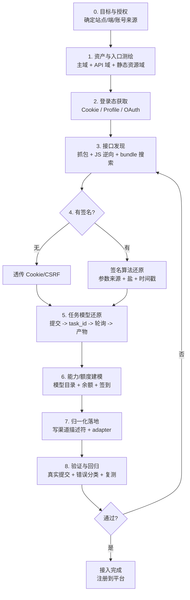
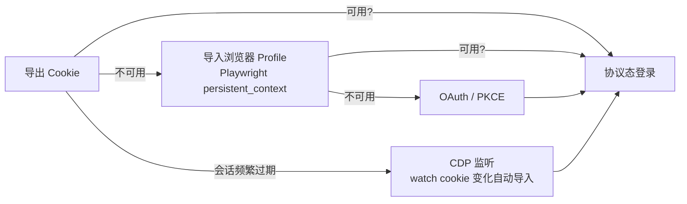
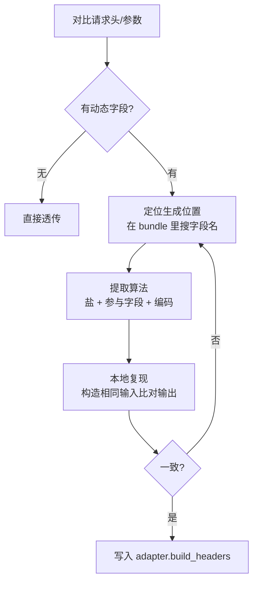
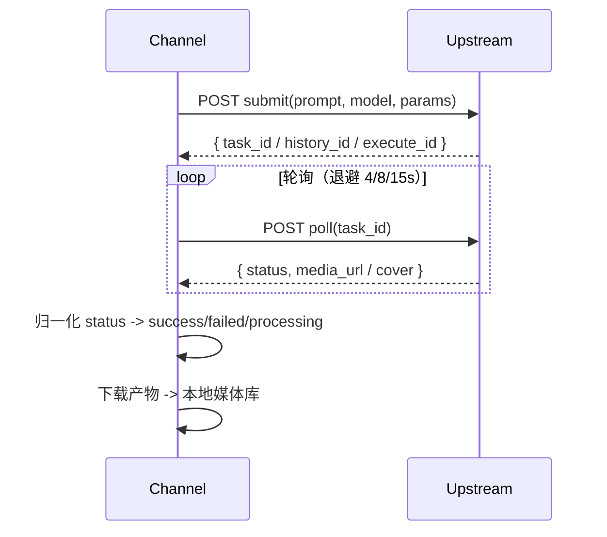
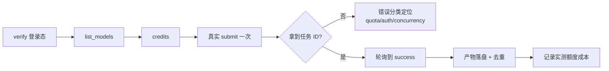

# 通用逆向分析流程（Web 反代 / xxx2api）

> 从 jimeng2api、tiktok2api、coze2api 三个项目的实战过程提炼。
> 目标：把一个"网页端能干的事"，变成"协议端可复现、可调度、可规模化"的接口。
> 本流程与具体站点无关，任何新渠道都按同一套走。

---

## 0. 总流程图



---

## 1. 资产与入口测绘

**动作**：把"一个页面"拆成"一组域名 + 一组请求"。

| 要收集 | 手法 | 三项目实例 |
|---|---|---|
| 主站域 | 浏览器地址栏 / 登录页 | `jimeng.jianying.com`、`ads.tiktok.com`、`coze.cn` |
| API 域 | DevTools Network 过滤 `XHR/Fetch` | 即梦全量走主域；coze 拆出 `api.coze.cn` / `code.coze.cn` / `www.coze.cn` |
| 静态资源域 | bundle / chunk | coze `code.coze.cn` 下的 `ideserver_api` |
| 出口约束 | 是否需代理 | tiktok 强制 `127.0.0.1:7897` |

**产出**：一张 `域名 -> 用途` 表。落点：渠道描述符的 `base_url` + `endpoints`。

**判据**：能列出至少 1 个业务 API 域 + 1 个鉴权域，否则继续找。

---

## 2. 登录态获取

按"成本从低到高"排序，优先协议态：



| 方式 | 何时用 | 项目实例 |
|---|---|---|
| Cookie 导入 | 有稳定 session cookie | tiktok `sessionid_ads`、jimeng `passport_csrf_token` |
| 浏览器 Profile | Cookie 易被绑定/指纹校验 | jimeng `data/profiles/<acc>`、coze 独立 profile |
| OAuth(PKCE) | 站点开放授权码流程 | coze `client_id + code_challenge` |
| CDP 监听 | 会话频繁轮换 | coze `watch-isolated-login.mjs` 轮询 cookie 自动导入 |

**关键约束**：
- 凭据**不落命令行、不落日志**；落库前用平台加密（DPAPI/XOR）。
- 拿到的 cookie 要立刻跑一次"验证接口"确认 `active`（见 §8）。

---

## 3. 接口发现（三条并行路径）

```mermaid
flowchart TD
    subgraph P1[抓包]
        A1[DevTools / mitmproxy<br/>记录 fetch+xhr] --> A2[去重 + 分类<br/>按 path 前缀聚类]
    end
    subgraph P2[JS 逆向]
        B1[下载 bundle] --> B2[搜关键字<br/>generate|task|workflow|sign]
        B2 --> B3[还原请求封装<br/>路径拼接 + 公共参数]
    end
    subgraph P3[协议推断]
        C1[已知 SDK 命名规律] --> C2[猜 RESTful 路径<br/>get_/list_/create_]
    end
    A2 --> D[接口清单<br/>method + path + 必填参数]
    B3 --> D
    C2 --> D
```

**手法要点**：
1. **抓包优先**：能点出来的操作，Network 一定有对应请求。用"点击 → 观察新增请求"逐个绑定业务动作。
2. **JS 逆向补充**：抓不到的（首次加载、条件分支）从 bundle 里搜。coze 的 `trace-coze-webapp-entry.mjs`、`inspect-public-bundle-routes.py` 就是干这个。
3. **路径聚类**：把几百条请求按前缀聚类成"接口族"，例如 tiktok 的 `.../cue/i2v/*`、`.../cue/t2v/*`，即梦的 `/mweb/v1/*`、`/commerce/v1/*`。
4. **静态镜像**：tiktok 的 `ALL_EXPORT_APIS.txt`（189 条 CUE 路径）就是一次全量导出的产物。

**产出**：`endpoints` 映射（见渠道描述符 schema）。落点：`config/channels/<name>.json`。

---

## 4. 签名与参数还原



| 签名类型 | 识别特征 | 项目实例 |
|---|---|---|
| 轻签名（固定盐 + MD5） | 头里一个 `Sign`，随路径/时间变 | jimeng：`md5('9e2c\|{path[-7:]}\|7\|8.4.0\|{ts}\|\|11ac')` |
| 无签名（Cookie+CSRF） | 只有 Cookie 与 CSRF 头 | tiktok：`X-csrftoken` + `x-creative-csrf-token` |
| OAuth Bearer | `Authorization: Bearer` | coze |
| 设备指纹 | `webid/tdid/uifid/a_bogus/fp` | jimeng 公共 query（浏览器态产出，透传即可） |

**公共参数**是逆向重点：即梦的 `aid=513695`、`web_version`、`device_platform=web` 等对每个请求都要带，还原后固化为描述符的 `endpoints[*].params` 或 adapter 的 `_default_params()`。

**红线**：签名值、token、cookie **只进内存与加密库**，绝不写进审计/日志（平台 `audit.py` 只记 `body_shape` 与头名）。

---

## 5. 任务模型还原（异步生成的通用骨架）

几乎所有 AI 生成站点都是"**提交 → 拿任务 ID → 轮询 → 取产物**"三段式：



| 站点 | 提交 | 轮询 | 任务 ID 字段 | 产物字段 |
|---|---|---|---|---|
| jimeng | `/mweb/v1/aigc_draft/generate` | `/mweb/v1/get_history_by_ids` | `history_id` | `video_url` |
| tiktok | `.../cue/{t2v,i2v}/create_generate_task` | `.../cue/generate-task/check` | `taskId` | `videoInfo[].MainUrl` |
| coze | `/api/workflow(_api)/run` | `/api/workflow(_api)/get_process` | `execute_id` | `nodeResults[].output` |

**归一化要点**：
- **状态机统一**为 `queued / submitted / processing / success / failed`。
- **成功判据**：必须拿到真实媒体直链；**缩略图/封面绝不算成功**（jimeng 踩过：webp/svg 预览被误判成视频）。
- **失败要分类**：`quota / auth_or_risk / concurrency / timeout / content / upstream`（见 §8）。

---

## 6. 能力与额度建模

| 目标 | 接口类型 | 项目实例 |
|---|---|---|
| 模型目录 | `get_common_config` / `model_list` | jimeng `model_list`、coze `project/model_list` |
| 额度 | `user_credit` / `balance/check` | jimeng `benefits/user_credit`、coze `credit/balance/check` |
| 签到 | `credit_receive` / `checkin` | jimeng `credit_receive` |
| 权益映射 | `benefit_metadata` | jimeng：`benefit_type` 决定计费口径 |

**区分"目录可见"与"真实可用"**：jimeng 明确区分 `catalog_available`（目录里有）与 `verified_available`（真实出片过）。只有后者才敢标可用。

---

## 7. 归一化落地

把上面全部结果落成两件产物：

1. **渠道描述符** `config/channels/<name>.json`（数据，不改代码）
2. **渠道适配器** `src/channels/<name>.py`（实现 `Channel` 接口，见 ADD_CHANNEL.md）

判据：描述符能覆盖 80% 的静态差异（域名/端点/模型/能力），adapter 只处理签名、payload 拼装、响应归一化三类动态逻辑。

---

## 8. 验证与回归



**必做**：
- 错误码映射表（把上游错误码翻译成统一 `error_class`）。
- 额度预检（余额不足直接本地返回 `quota`，不发上游、不启浏览器）——jimeng 的省资源优化。
- 脱敏审计 + 真实提交样本留档。

**判定"假点"**：目录里有模型 ≠ 能生成；页面能点 ≠ 协议可复现。只有"真实出片 + 落盘 MP4"才算 `verified_available`。

---

## 附：三项目关键参数速查

| 项 | jimeng | tiktok | coze |
|---|---|---|---|
| 鉴权头 | `Sign` + `Appid` + `Device-Time` | `X-csrftoken` | `Authorization: Bearer` |
| 公共 query | `aid=513695,web_version=7.5.0` | 无 | 无 |
| 提交体 | `draft_content`(JSON 串) | `settings`(JSON 串) | `input`/`parameters` |
| 任务 ID | `history_id` | `taskId` | `execute_id` |
| 轮询间隔 | 6s（退避 4/8/15） | 配置 `poll_interval` | 2s→12s |
| 额度不足码 | `1006/1007` | — | `402` |
| 并发上限码 | `1310` | — | `429` |
