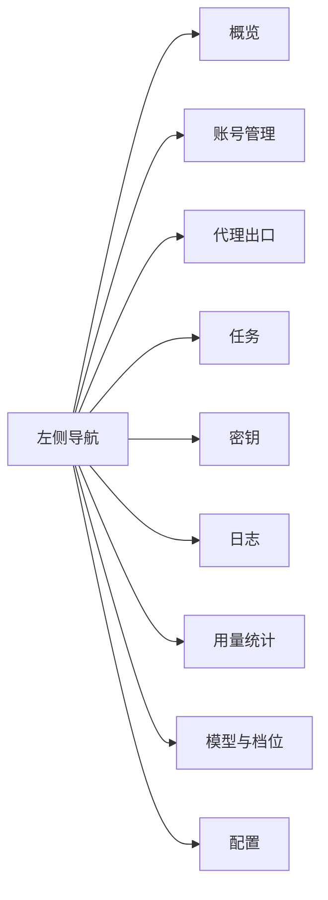

# 控制台页面与功能清单

> 对齐 `workbuddy2api-panel` 的 8 个页面，落地为 9 个页面（多一个「密钥」，因为本平台是多租户 API Key 模型）。
> 前端：`static/{index.html,style.css,app.js}`；后端：`src/api/*.py`。

---

## 0. 页面总览



| # | 页面 | hash | 后端主要接口 |
|---|---|---|---|
| 1 | 概览 | `#overview` | `/health` `/api/summary` `/api/stats/overview` `/api/channels` |
| 2 | 账号管理 | `#accounts` | `/api/accounts*` `/api/ops/*` `/api/sessions` `/api/proxy/accounts` |
| 3 | 代理出口 | `#proxies` | `/api/proxy/*` |
| 4 | 任务 | `#jobs` | `/api/jobs*` |
| 5 | 密钥 | `#keys` | `/api/keys*` |
| 6 | 日志 | `#logs` | `/api/audit` |
| 7 | 用量统计 | `#usage` | `/api/stats/usage` `/api/stats/credits` `/api/stats/runtime` |
| 8 | 模型与档位 | `#models` | `/api/models*` |
| 9 | 配置 | `#config` | `/api/config*` |

---

## 1. 概览

- 8 张统计卡：渠道数 / 账号总数 / 活跃 / 冷却 / 任务总数 / 成功 / 失败 / 待处理
- 渠道卡片：名称、能力标签、账号数 / 任务数 / 模型数

## 2. 账号管理（核心）

**按渠道分组**（即梦 / TikTok / 扣子），可折叠。

表格列：健康色条 / 账号（名 + ID）/ 渠道 / 状态 / **出口 IP** / 积分（剩余/总额）/ 成功·失败 / 会话健康 / 操作

**顶部批量操作**（`/api/ops/*`）：

| 按钮 | 接口 | 说明 |
|---|---|---|
| 全部检查 | `POST /api/ops/verify-all` | 逐账号验证登录态 |
| 全部签到 | `POST /api/ops/checkin-all` | 逐账号签到 |
| 全部保活 | `POST /api/ops/keepalive-all` | 触发一轮会话保活 |
| 全部刷新额度 | `POST /api/ops/balance-all` | 逐账号拉取额度 |

**行操作**：检查 / 签到 / 编辑 / 备份 / 删除；顶部「导入账号」（Cookie 文本或文件上传）。

## 3. 代理出口

- 统计条：已绑定 / 未绑定 / 同 IP 超限账号数
- 表格：账号 / 代理链接（脱敏）/ 声明 IP / 实测 IP / 状态徽章 / 操作（配置 / 校验 / 直连）
- 顶部：「全部校验」「批量导入」（贴文本，每行 `账号ID 代理链接 [声明IP] [备注]`）
- 订阅池区：global / cn 两 realm，展示订阅数 / 解析条目 / 健康分布，可保存 / 刷新 / 清空

## 4. 任务

任务列表：健康色条 / ID / 渠道 / 模型 / 状态（+错误分类）/ 创建时间 / 取消操作。按状态筛选。

## 5. 密钥

API Key 列表：名称 / 前缀（`u2a_xxx_***`）/ 状态 / 创建时间 / 最后使用 / 操作（查看明文 / 启停 / 删除）。可新建。

## 6. 日志

- 频道筛选 chips：全部 / 任务 / 对话 / 系统
- 统计条：24h 事件数 + 按渠道分布
- 事件表：时间 / 类别 / 渠道 / 账号 / 方法 / URL / 状态

## 7. 用量统计（新增）

- 统计条：任务总数 / 成功 / 失败 / 成功率
- **按渠道**横向柱状图（渠道 | 轨道 | 数量 | 成功率）
- **按模型**横向柱状图
- **按日趋势**（最近 N 天）
- **按账号**表格
- 筛选：7 / 14 / 30 天 + 渠道下拉

数据源：`GET /api/stats/usage?days=7&channel=`（聚合在 SQL 层，`date(created_at,'unixepoch')` 按日补零）

## 8. 模型与档位（新增）

- 按渠道分组模型卡：别名 / 上游 ID / 类型 / 是否支持图生视频 / 规格（分辨率、时长）
- 搜索过滤
- 顶部：「刷新目录」（`/api/config/reload`）、「探测实时目录」（选渠道 → `POST /api/models/{channel}/probe`）

数据源：`GET /api/models`（27 个模型：jimeng 17 / tiktok 8 / coze 2）

## 9. 配置（新增）

- 分区可编辑：`antiban` / `session` / `proxy` / `job` / `checkin` / `api`
- 每项按类型渲染控件（bool → checkbox，number → number，str → text）
- 逐节「保存」→ `POST /api/config`，二次确认
- 渠道描述符区：列出渠道（名称/类型/base_url/能力/模型数），可展开看 JSON 原文
- 显示配置文件路径

**写入安全**：
- 只允许白名单节与键，其余 400 并列出允许项
- 逐行替换保留原注释与格式（不整体重写）
- 临时文件 + `os.replace` 原子替换，写后热重载
- `api_key` 返回时脱敏为 `***`

---

## 10. 后端新增接口汇总

### 统计用量（`src/api/stats_routes.py`）
```
GET /api/stats/overview   渠道+总计概览
GET /api/stats/usage      按渠道/模型/账号/日
GET /api/stats/credits    积分构成
GET /api/stats/runtime    运行态（待处理任务/审计/会话）
```

### 配置（`src/api/config_routes.py`）
```
GET  /api/config                    当前配置（api_key 脱敏）
POST /api/config                    白名单写入 + 热重载
GET  /api/config/channels           渠道描述符列表
GET  /api/config/channels/{name}    描述符原文
POST /api/config/channels/{name}    更新描述符 + 热重载
POST /api/config/reload             重载配置与注册表
```

### 批量运维 + 模型（`src/api/ops_routes.py`）
```
POST /api/ops/checkin-all?channel=   全部签到
POST /api/ops/keepalive-all          全部保活
POST /api/ops/balance-all?channel=   全部刷新额度
POST /api/ops/verify-all?channel=    全部检查
POST /api/ops/antiban-reset          重置熔断
GET  /api/ops/status                 运行态汇总
GET  /api/models                     聚合全部渠道模型
GET  /api/models/{channel}           单渠道模型明细
POST /api/models/{channel}/probe     探测实时目录
GET  /api/models/{channel}/specs     规格与能力
```

**批量操作语义**：串行执行、单个失败不影响后续、逐条返回结果。

---

## 11. 验证

```powershell
cd E:\API管理工具\any-video2api
$env:PYTHONPATH="."
python -m uvicorn main:app --host 127.0.0.1 --port 8800
# 浏览器 http://127.0.0.1:8800/console
```

已实测：9 个导航项 = 9 个视图；统计 4 接口、配置 6 接口、模型 4 接口、运维 6 接口、代理 13 接口全部 200；
配置写入白名单生效且 toml 原注释未被破坏；`api_key` 脱敏为 `***`。
